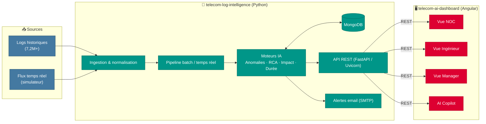

# 📡 Telecom AIOps — Supervision intelligente et proactive des infrastructures télécoms

[](https://www.python.org)
[](https://www.mongodb.com)
[](https://fastapi.tiangolo.com)
[](https://angular.dev)
[](https://scikit-learn.org)

> Projet de Fin d'Études réalisé en collaboration avec **Tunisie Télécom** et **SICAP** : transformer des volumes massifs de logs applicatifs télécoms (**7,2M+ logs**) en un levier décisionnel intelligent, avec détection d'anomalies, analyse des causes racines (RCA), prédiction d'impact et un dashboard multi-rôles (NOC / Ingénieur / Manager).

Ce dépôt regroupe les **deux composants** de la plateforme :

| Composant | Rôle | README détaillé |
|---|---|---|
| 🧠 [`telecom-log-intelligence`](telecom-log-intelligence) | Backend Python — ingestion, ML, détection d'anomalies, RCA, API REST | [Voir le README](telecom-log-intelligence/README.md) |
| 🖥️ [`telecom-ai-dashboard`](telecom-ai-dashboard) | Frontend Angular — dashboard multi-rôles, visualisations temps réel | [Voir le README](telecom-ai-dashboard/README.md) |

---

## 📋 Sommaire

- [Contexte](#-contexte)
- [Architecture globale](#-architecture-globale)
- [Résultats clés](#-résultats-clés)
- [Backend — Telecom Log Intelligence](#-backend--telecom-log-intelligence)
- [Frontend — Telecom AI Dashboard](#-frontend--telecom-ai-dashboard)
- [Démarrage rapide](#-démarrage-rapide)
- [Auteur](#-auteur)

---

## 🎯 Contexte

Les applications télécoms génèrent quotidiennement des volumes massifs de logs techniques. La supervision traditionnelle — dashboards descriptifs, approche réactive — montre ses limites face à la complexité croissante des systèmes.

**Telecom AIOps** propose une supervision proactive qui :
- exploite de grands volumes de logs applicatifs (7,2M+ logs) ;
- détecte les anomalies en temps réel (embeddings + Isolation Forest) ;
- identifie automatiquement les causes racines et les cascades d'incidents multi-plateformes ;
- prédit l'impact client et la durée de résolution ;
- recommande des actions de remédiation ;
- expose le tout via une API REST et un dashboard adapté à trois profils utilisateurs (NOC, Ingénieur, Manager).

## 🏗️ Architecture globale



## 📊 Résultats clés

| Métrique | Valeur |
|---|---:|
| Volume de logs traité | **7 224 549** |
| Anomalies détectées | **47 278** (0,657 %) |
| Clusters identifiés | 94 |
| Liens causaux découverts | 8 |
| Latence recherche FAISS (7,2M vecteurs) | < 10 ms |
| Endpoints API REST | 59 |
| Plateformes supervisées | MMG, SMSC, SMPPS, SMPPC, DMC |

**Exemple réel de synthèse produite par l'orchestrateur (pipeline temps réel)** :

```
ORCHESTRATION SUMMARY
Detected anomalies: 20
Clusters: 1
Root causes: [('fail', 22.5)]
Propagation path: ['DMC', 'MMG']
Severity: CRITICAL
Alerts saved: 3
Operator priority: IMMEDIATE ACTION
Email alert: sent successfully
```

**Exemple de schéma d'alerte intelligente (mode batch, 47 278 anomalies)** :

```json
{
  "type": "REALTIME_ANOMALY",
  "severity": "CRITICAL",
  "alert_rank_score": 100,
  "operator_priority": "IMMEDIATE ACTION",
  "propagation_path": ["SMPPS", "MMG", "DMC", "SMPPC"],
  "platforms_affected": 4,
  "anomaly_count": 47278,
  "immediate_actions": ["restart_smpp_pool", "escalate_noc"],
  "created_at": "2026-01-15T03:42:20Z"
}
```

---

## 🧠 Backend — Telecom Log Intelligence

**Stack** : Python 3.14 · Sentence-Transformers (MiniLM-384) · Détection hybride (Isolation Forest + LOF + TF-IDF) · Scikit-learn · MongoDB · FAISS (IVFPQ + IDMap2) · FastAPI (Uvicorn) · Pandas/NumPy

**Fonctionnalités principales** :
- **Détection hybride d'anomalies** (Isolation Forest + LOF + TF-IDF, via embeddings sémantiques MiniLM-384) avec seuils dynamiques
- **Root Cause Analysis (RCA)** : inférence causale, détection de cascades d'incidents multi-plateformes
- **Prédiction d'impact et de durée** de résolution
- **Auto-remédiation** : recommandations d'actions contextuelles
- **Supervision temps réel** : simulateur de flux + pipeline par batch
- **API REST** : vue d'ensemble, anomalies, RCA, timeline, heatmap, prédictions, alertes...

👉 Documentation complète, installation, liste des endpoints et variables d'environnement : **[telecom-log-intelligence/README.md](telecom-log-intelligence/README.md)**

## 🖥️ Frontend — Telecom AI Dashboard

**Stack** : Angular 20 · Angular Material · Chart.js · ECharts (`ngx-echarts`) · RxJS

**Fonctionnalités principales** :
- **Trois vues par rôle** : NOC, Ingénieur, Manager — chacune adaptée à son usage métier
- **RCA Panel** : exploration visuelle des causes racines
- **Cascade Timeline** : visualisation de la propagation des incidents entre plateformes
- **Anomaly Table** : liste et filtrage des anomalies détectées
- **AI Copilot** : assistant d'aide à la décision
- **What-if Simulator** : simulation de scénarios
- **Drift Monitor** & **Feedback Loop** : suivi de la dérive des modèles et boucle de retour
- **Similarity Search** : recherche d'incidents similaires

👉 Documentation complète et commandes Angular CLI : **[telecom-ai-dashboard/README.md](telecom-ai-dashboard/README.md)**

---

## ⚙️ Démarrage rapide

### Backend
```bash
cd telecom-log-intelligence
python -m venv venv
source venv/bin/activate  # Windows : venv\Scripts\activate
pip install -r requirements.txt
cp .env.example .env      # puis renseigner MongoDB, SMTP, etc.

python -m dashboard.dashboard_api
# API disponible sur http://localhost:8000
```

### Frontend
```bash
cd telecom-ai-dashboard
npm install
ng serve
# Application disponible sur http://localhost:4200
```

> Détails complets (pipeline batch, orchestrateur IA, simulateur temps réel, tests) dans le README du backend.

> ⚠️ **Sécurité** : le code contient un secret JWT de repli codé en dur (`"telecom_pfe_secret_2026"`, utilisé si `JWT_SECRET` n'est pas défini). Définis systématiquement `JWT_SECRET` dans ton `.env` avec une valeur forte et aléatoire avant tout déploiement au-delà d'un usage local.

---

## 👤 Auteur

**Cherni Mohamed Amine**
Projet de Fin d'Études (Génie Informatique) — soutenu le 30/06/2026, réalisé en collaboration avec Tunisie Télécom et SICAP
Encadrante académique : Mme Sana Hamdi · Encadrant professionnel : M. Badreddine Babay

- 🔗 [LinkedIn](https://www.linkedin.com/in/cherni-mohamed-amine-40158b2b1/)
- 💻 [GitHub](https://github.com/cherniamine)
- 📧 chernimohamedamine551@gmail.com

---

## 📄 Licence

Projet développé dans le cadre académique du PFE. Tous droits réservés — contacter l'auteur pour toute réutilisation.