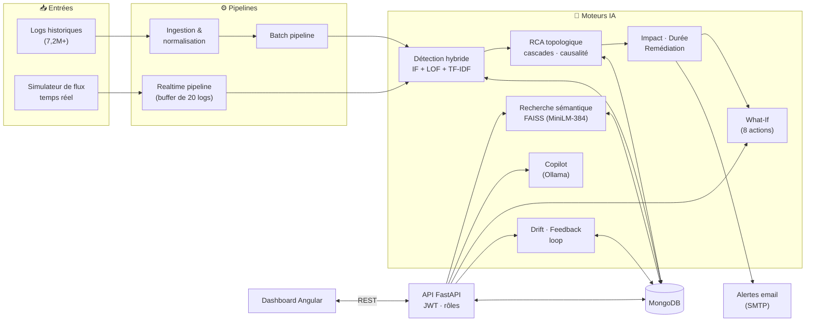

# 🧠 Telecom Log Intelligence — Backend AIOps

[](https://www.python.org)
[](https://fastapi.tiangolo.com)
[](https://www.mongodb.com)
[](https://scikit-learn.org)
[](https://github.com/facebookresearch/faiss)
[](https://www.docker.com)

> Moteur d'intelligence AIOps qui transforme des millions de logs applicatifs télécoms en décisions : détection hybride d'anomalies, analyse des causes racines (RCA), prédiction d'impact et de durée, simulation d'actions correctives (What-If), recherche sémantique FAISS et copilote IA — exposés via une API REST FastAPI sécurisée par rôles.

Backend du projet **[Telecom AIOps](../README.md)** (Projet de Fin d'Études, **Tunisie Télécom** × **SICAP**). Le frontend associé est dans [`telecom-ai-dashboard`](../telecom-ai-dashboard/README.md).

---

## 📋 Sommaire

- [Résultats clés](#-résultats-clés)
- [Architecture](#-architecture)
- [Fonctionnalités](#-fonctionnalités)
- [Stack technique](#-stack-technique)
- [Installation](#-installation)
- [Exécution](#-exécution)
- [API REST](#-api-rest)
- [Configuration](#-configuration)
- [Docker](#-docker)
- [Tests](#-tests)
- [Sécurité et limites connues](#-sécurité-et-limites-connues)
- [Perspectives](#-perspectives)
- [Structure du projet](#-structure-du-projet)
- [Auteur](#-auteur)

---

## 📊 Résultats clés

| Métrique | Valeur |
|---|---:|
| Logs historiques traités | **7 224 549** |
| Anomalies détectées | **47 278** (0,657 %) |
| Clusters d'incidents | 94 |
| Liens causaux découverts | 8 |
| Plateformes supervisées | **5** — MMG, SMSC, SMPPS, SMPPC, DMC |
| Recherche sémantique FAISS | < 10 ms sur 7,2M de vecteurs |
| Endpoints API | ~60 |

## 🏗️ Architecture



## ✨ Fonctionnalités

**1. Détection hybride d'anomalies** (`ai/engine`, `ml/`)
Combinaison de trois détecteurs complémentaires : **Isolation Forest**, **Local Outlier Factor** (mode novelty) et **TF-IDF** (composante textuelle), appliqués à des embeddings sémantiques **all-MiniLM-L6-v2** (384 dimensions), avec seuils dynamiques par plateforme.

**2. Root Cause Analysis topologique** (`ai/engine`)
Inférence causale, clustering d'anomalies et détection de **cascades d'incidents** entre plateformes selon la topologie télécom (`config/topology.yaml`).

**3. Prédiction d'impact, de durée et remédiation** (`ai/decisioning`, `ai/prediction`, `ml/incident`)
Estimation de l'impact client (HIGH / MEDIUM / LOW), de la durée de résolution, de l'évolution de l'incident et recommandation automatique d'actions de remédiation.

**4. Simulateur What-If** (`ai/engine`)
Comparaison de **8 actions correctives** (capacité de file SMSC, redémarrage des sessions SMPP, réduction des retries, isolation de plateforme, plan combiné…) avec gain de MTTR estimé, niveau de confiance et de risque.

**5. Recherche sémantique FAISS** (`similarity/`)
Index **IVFPQ** sur les embeddings de logs : retrouve les logs et incidents similaires à partir d'un texte, d'un log existant ou d'un incident.

**6. Copilote IA** (`llm/`)
Assistant d'aide à la décision et d'explication d'incident, basé sur un LLM local servi par **Ollama** (modèle par défaut : `mistral`).

**7. Drift et boucle de feedback** (`ml/`, `monitoring/`)
Détection de dérive des modèles, retours opérateurs sur les anomalies (faux positifs / vrais positifs) et déclenchement de ré-entraînement supervisé.

**8. Supervision temps réel et alerting** (`realtime/`, `pipeline/`, `ai/notification`)
Simulateur de flux, traitement par lots, déduplication des alertes (`ALERT_DEDUP_SECONDS`) et envoi d'emails SMTP.

**9. API multi-rôles** (`dashboard/`)
Authentification **JWT** et vues dédiées **NOC**, **Manager** et **Ingénieur**.

## 🛠️ Stack technique

| Couche | Technologies |
|---|---|
| Langage | Python (3.11+ ; image Docker en 3.11) |
| API | FastAPI · Uvicorn · Pydantic · PyJWT |
| ML / NLP | scikit-learn · sentence-transformers (all-MiniLM-L6-v2) · joblib · NetworkX |
| Recherche vectorielle | FAISS (IVFPQ + IDMap2) |
| Données | MongoDB · Pandas · NumPy · PyArrow |
| LLM | Ollama (`mistral` par défaut) |
| Alertes | SMTP (Gmail) |
| Infra | Docker · Docker Compose |

## ⚙️ Installation

### Prérequis
- Python 3.11+
- MongoDB (local, ou via Docker Compose — voir [Docker](#-docker))
- [Ollama](https://ollama.com) *(optionnel — uniquement pour le copilote IA)*

### Étapes

```bash
# 1. Cloner le dépôt
git clone https://github.com/cherniamine/telecom-aiops.git
cd telecom-aiops/telecom-log-intelligence

# 2. Environnement virtuel
python -m venv venv
source venv/bin/activate        # Linux / macOS
.\venv\Scripts\activate         # Windows

# 3. Dépendances
pip install -r requirements.txt

# 4. Configuration
cp env.example .env             # puis renseigner les valeurs (voir Configuration)
```

> 📌 Les **données** (logs, embeddings, index FAISS) et les **modèles entraînés** ne sont pas versionnés (voir `.gitignore`). Contacter l'auteur pour y accéder.

## 🏃 Exécution

**1. Pipeline batch** — analyse de l'historique (détection, clustering, RCA)
```bash
python -m pipeline.batch_pipeline
```

**2. Orchestrateur IA** — analyse complète (impact, durée, remédiation, incidents similaires)
```bash
python -m ai.orchestrator.telecom_ai_orchestrator
```

**3. Temps réel** — simulateur + pipeline
```bash
# Terminal 1 : simulateur de flux
python -m realtime.log_stream_simulator

# Terminal 2 : pipeline temps réel
python -m pipeline.realtime_pipeline
```
Ou, en une commande (pipeline temps réel + boucle d'analyse IA) :
```bash
python main.py
```

**4. API Dashboard**
```bash
python -m dashboard.dashboard_api
# API       → http://localhost:8000
# Swagger   → http://localhost:8000/docs
```

Exemple d'appel :
```bash
curl http://localhost:8000/dashboard/overview
```

## 📡 API REST

~60 endpoints exposés par FastAPI (documentation interactive sur `/docs`).

| Domaine | Endpoints principaux |
|---|---|
| **Authentification** | `POST /auth/login` · `GET /dashboard/me` |
| **Vue NOC** *(JWT : noc, engineer)* | `GET /dashboard/noc/alerts` · `/noc/queue` · `/noc/realtime` |
| **Vue Manager** *(JWT : manager, engineer)* | `GET /dashboard/manager/kpis` · `/manager/trends` · `/manager/sla-report` |
| **Vue Ingénieur** *(JWT)* | `GET /dashboard/engineer/ml-metrics` · `/engineer/details/{incident_id}` · `/engineer/logs/raw` |
| **Supervision** | `GET /health` · `/dashboard/overview` · `/anomalies` · `/timeline` · `/heatmap` · `/system-status` |
| **Incidents & alertes** | `GET /dashboard/incidents` · `/incidents/history` · `/alerts` · `/alerts/stats` · `/email-alerts` · `POST /incidents/{id}/resolve` |
| **RCA & prédiction** | `GET /dashboard/rca` · `/impact` · `/duration` · `/evolution` · `/remediation` · `/intelligence` · `/predictions` |
| **What-If** | `GET /dashboard/what-if/actions` · `POST /what-if/simulate` · `/what-if/compare` · `GET /what-if/best-action/{incident_id}` |
| **Recherche sémantique (FAISS)** | `POST /dashboard/similar-logs/search` · `GET /similar-logs/{log_index}` · `/similar-incidents/{id}` · `/faiss/stats` · `POST /faiss/build` |
| **Copilote IA** | `POST /dashboard/copilot/ask` · `/explain` · `GET /copilot/panel` · `/copilot/model` |
| **Drift** | `GET /dashboard/model-drift` · `/model-drift/latest` · `/model-drift/history` · `POST /model-drift/analyze` · `/model-drift/set-reference` |
| **Feedback** | `POST /dashboard/feedback/anomaly/{id}` · `/feedback/anomaly/batch` · `GET /feedback/stats` · `/feedback/pending` · `POST /feedback/retrain` |

Les chemins ci-dessus sont relatifs à `/dashboard` (sauf `/auth` et `/health`).

## 🔧 Configuration

Copier [`env.example`](env.example) vers `.env`. Variables principales :

| Variable | Rôle | Défaut |
|---|---|---|
| `MONGO_URI` | Connexion MongoDB | `mongodb://mongodb:27017` (valeur de `settings.py`) |
| `DATABASE_NAME` | Base de données | `telecom_logs` |
| `COLLECTION_NAME` / `ANOMALY_COLLECTION` / `ALERT_COLLECTION` | Collections MongoDB | `log_features` / `anomalies` / `alerts` |
| `JWT_SECRET` | Secret de signature des jetons | ⚠️ **à définir** (voir Sécurité) |
| `EMAIL_ALERT_SENDER` / `EMAIL_ALERT_PASSWORD` / `EMAIL_ALERT_RECIPIENTS` | Alertes SMTP (mot de passe d'application) | — |
| `DASHBOARD_API_HOST` / `DASHBOARD_API_PORT` | Hôte et port de l'API | `127.0.0.1` / `8000` |
| `OLLAMA_MODEL` / `OLLAMA_URL` / `OLLAMA_TIMEOUT_SECONDS` | Copilote IA | `mistral` / `http://127.0.0.1:11434/api/generate` / `30` |
| `REALTIME_BUFFER_SIZE` / `REALTIME_BUFFER_MAX_WAIT_SECONDS` | Pipeline temps réel | `20` / `5` |
| `SIMULATOR_*` | Paramètres du simulateur de flux | voir `env.example` |
| `FAISS_EMBEDDINGS_PATH` / `FAISS_DATASET_PATH` | Fichiers sources de l'index FAISS | voir `env.example` |

> Utiliser un **mot de passe d'application** Gmail dédié, jamais le mot de passe principal du compte.

## 🐳 Docker

Le dossier [`docker/`](docker) fournit un `docker-compose.yml` qui démarre **MongoDB** (avec healthcheck) et un conteneur d'**ingénierie de features** (`analysis/feature_engineering.py`) :

```bash
cd docker
docker compose up --build
```

> L'API FastAPI n'est pas (encore) conteneurisée : elle se lance en local avec `python -m dashboard.dashboard_api`. Pour ne démarrer que la base : `docker compose up mongodb`.

## 🧪 Tests

Suite de tests **pytest** (18 modules dans `tests/` : moteurs d'anomalies, RCA, topologie, What-If, drift, alertes, pipelines, API…).

```bash
pytest tests/
pytest tests/test_what_if_engine.py      # un module précis
pytest --cov=. tests/                    # avec couverture (pytest-cov requis)
```

> Certains tests supposent une base MongoDB accessible et/ou un index FAISS disponible.

## 🔐 Sécurité et limites connues

Transparence sur l'état actuel du projet (prototype académique) :

- **Secret JWT de repli** : si `JWT_SECRET` n'est pas défini, le code utilise une valeur par défaut codée en dur. Toujours définir un secret fort et aléatoire hors démonstration locale.
- **Comptes de démonstration** : les utilisateurs `noc_operator`, `manager_demo` et `engineer_demo` sont définis en dur (`DEMO_USERS`). À remplacer par un vrai annuaire pour tout usage réel.
- **Périmètre de l'authentification** : seuls les endpoints des vues par rôle (`/dashboard/noc/*`, `/manager/*`, `/engineer/*`, `/me`) vérifient le JWT. Les endpoints d'analyse et d'action (`/dashboard/overview`, `/incidents/{id}/resolve`, `/faiss/build`, `/feedback/retrain`, `/model-drift/set-reference`…) **ne sont pas encore protégés** — à sécuriser avant toute exposition réseau.
- **CORS** : `allow_origins=["*"]` — à restreindre au domaine du dashboard en production.
- **Configuration partielle en dur** : `main.py` définit l'URI MongoDB directement dans le code.
- **Données non versionnées** : logs, embeddings, index FAISS et modèles ne figurent pas dans le dépôt.

## 🔭 Perspectives

- Protéger l'ensemble des endpoints par JWT + permissions fines (RBAC)
- Conteneuriser l'API et le frontend (Docker Compose complet) et ajouter un pipeline CI/CD
- Diffusion temps réel par WebSocket vers le dashboard
- *Digital Twin* du réseau pour simuler la propagation des incidents (prototype minimal dans `ai/engine/telecom_digital_twin_engine.py`)
- Modélisation des dépendances télécoms par *Graph Neural Networks* (heuristique de graphe de dépendances dans `ai/engine/telecom_gnn_rca_engine.py`, à remplacer par un vrai GNN)

## 📁 Structure du projet

```
telecom-log-intelligence/
├── ai/
│   ├── orchestrator/     # Orchestrateur IA, support de décision, incidents
│   ├── engine/           # Anomalies, seuils, RCA, topologie, What-If, propagation
│   ├── decisioning/      # Estimation d'impact, prédiction de durée
│   ├── prediction/       # Évolution, similarité, remédiation automatique
│   └── notification/     # Alertes email
├── analysis/             # Feature engineering
├── config/               # settings.py, constants, topology.yaml, logging
├── dashboard/            # API FastAPI (dashboard_api.py, multi_role_dashboard.py)
├── database/             # Client MongoDB
├── docker/               # Dockerfile + docker-compose.yml
├── docs/                 # Documentation et diagrammes
├── ingestion/            # Parsing et normalisation des logs
├── llm/                  # Copilote IA (Ollama)
├── ml/                   # Entraînement, évaluation, inférence, sévérité/recommandations
├── monitoring/           # Suivi de dérive
├── notebooks/            # Exploration et prototypage
├── pipeline/             # Pipelines batch et temps réel
├── realtime/             # Simulateur de flux
├── services/             # Services métier
├── similarity/           # Index et recherche FAISS
├── tests/                # Tests pytest
├── env.example
├── main.py               # Pipeline temps réel + boucle d'analyse IA
└── requirements.txt
```

Guides complémentaires : [`QUICK_REFERENCE.md`](QUICK_REFERENCE.md) · [`REALTIME_PIPELINE_QUICK_START.md`](REALTIME_PIPELINE_QUICK_START.md)

## 👤 Auteur

**Cherni Mohamed Amine** — Projet de Fin d'Études, Génie Informatique (soutenu le 30/06/2026)
Réalisé avec **Tunisie Télécom** et **SICAP** · Encadrante académique : Mme Sana Hamdi · Encadrant professionnel : M. Badreddine Babay

- 💻 [GitHub](https://github.com/cherniamine) · 🔗 [LinkedIn](https://www.linkedin.com/in/cherni-mohamed-amine-40158b2b1/)
- 📧 chernimohamedamine551@gmail.com

## 📄 Licence

Projet développé dans le cadre académique d'un PFE. Tous droits réservés — contacter l'auteur pour toute réutilisation.
